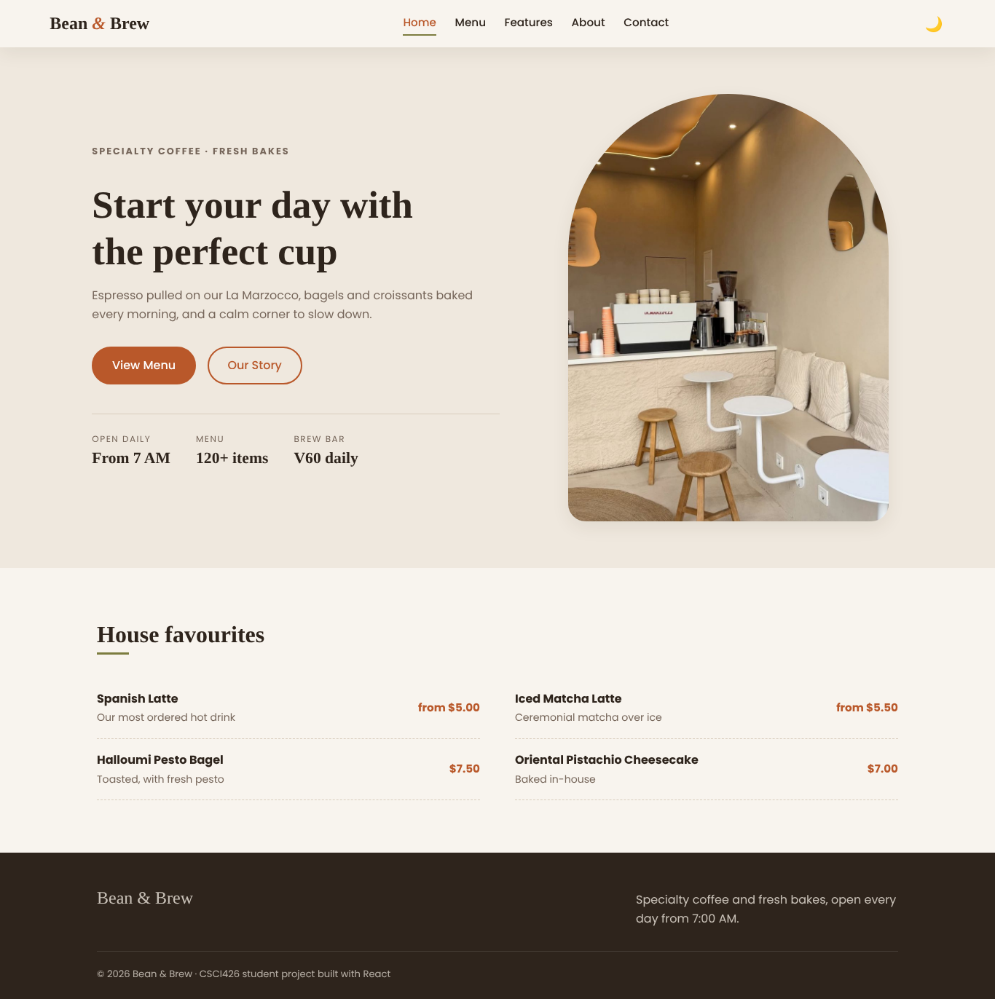
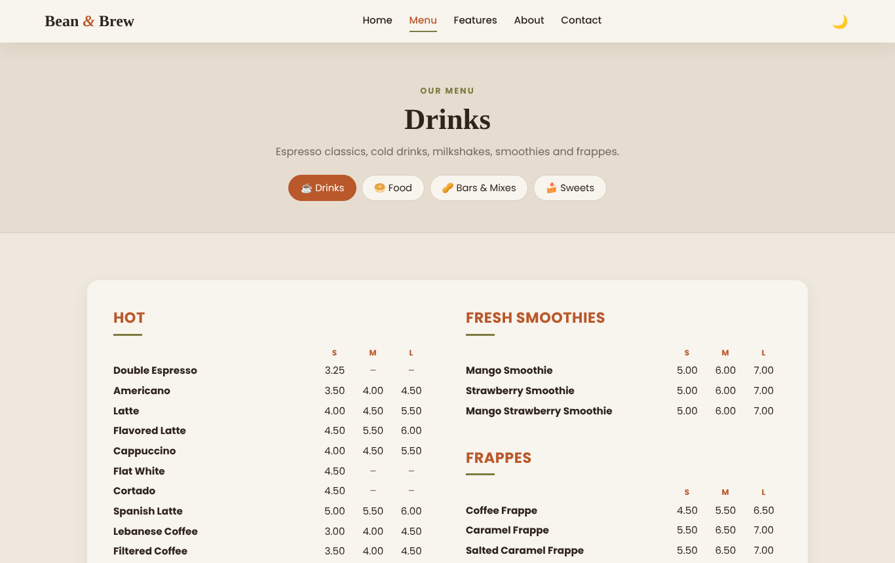
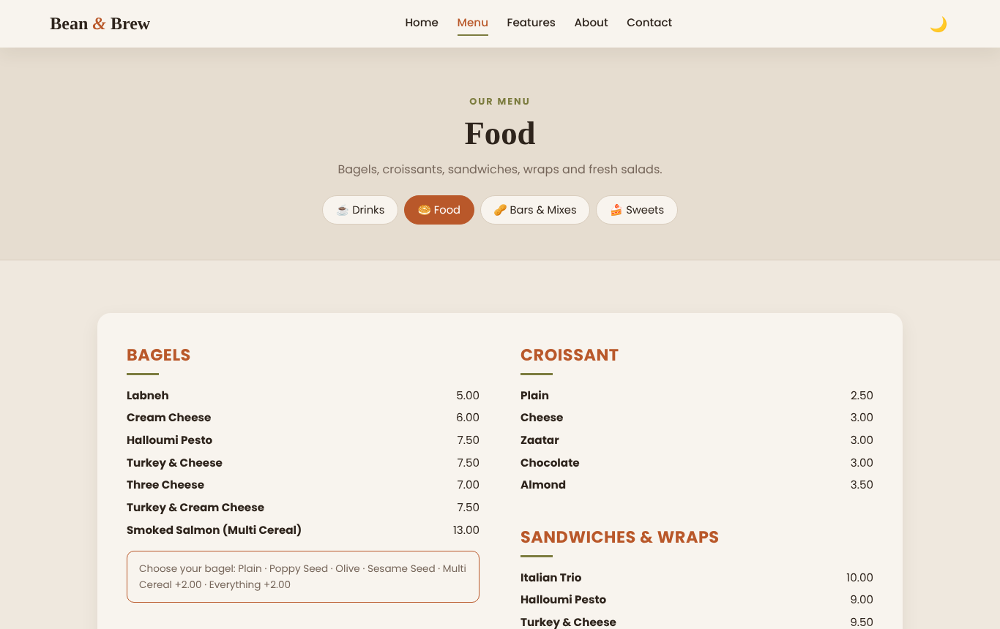
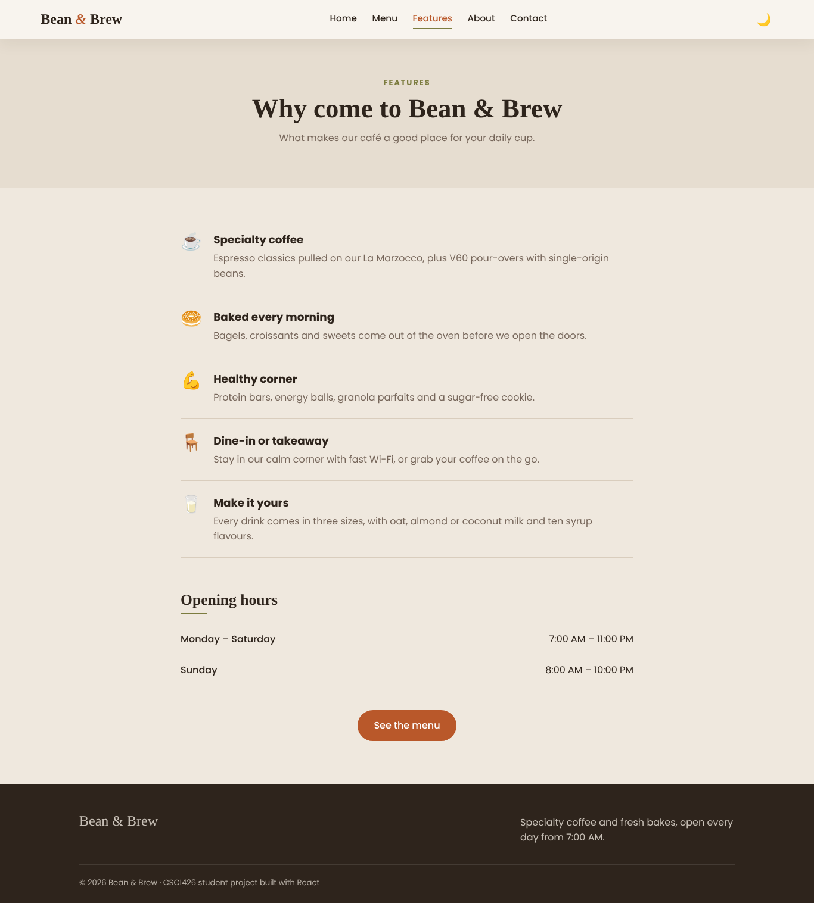
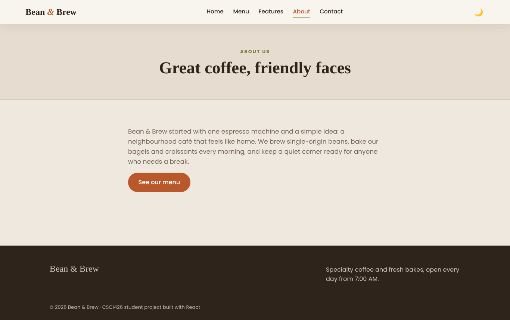
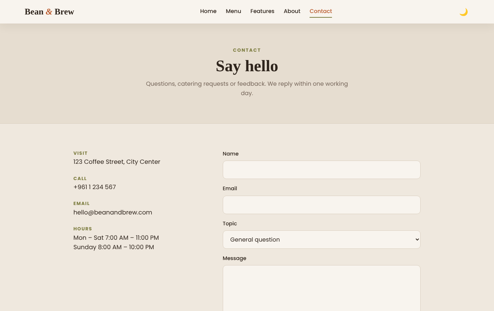
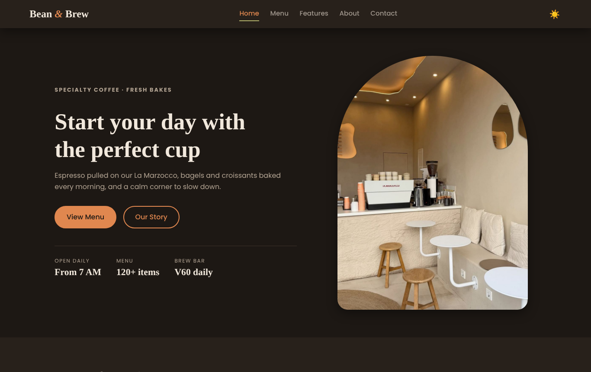
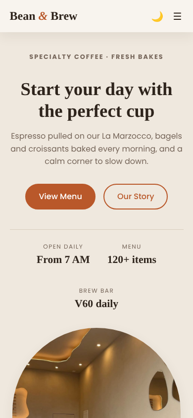
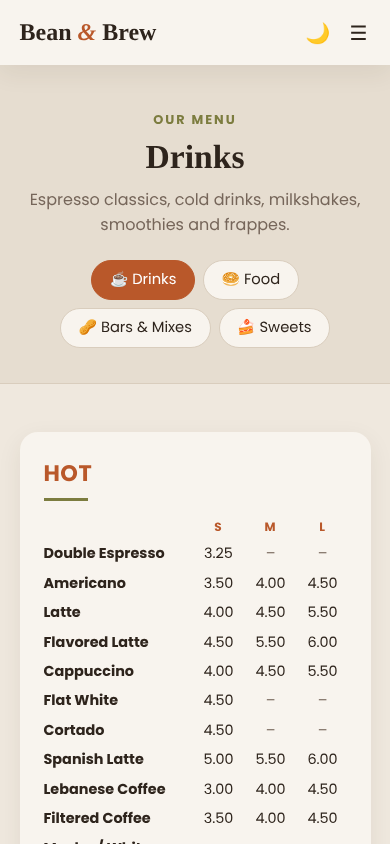

# Bean & Brew — Coffee Shop Website

**CSCI426 Advanced Web Programming — Project Phase 1**
Theme: Coffee shop menu website (based on Theme 4, Restaurant System: menu display)

🔗 **Live demo:** `https://YOUR-LINK-HERE` *(replace after deploying)*
🔗 **Repository:** `https://github.com/YOUR-USERNAME/bean-and-brew`



## Project description

Bean & Brew is a frontend web application for a specialty coffee shop. It solves a real problem
for customers: reading a long menu on a small paper board while standing in line. With the website, a customer can:

- Browse the full café menu (120+ items) by category, with Small / Medium / Large prices for drinks
- Switch between Drinks, Food, Bars & Mixes and Sweets with tabs at the top of the menu
- See the add-ons (milk, extra ingredients, syrups) and their prices
- Read about the café's features and opening hours, and send a message through a validated contact form

The site is fully responsive (desktop, tablet and phone) and has a light and dark mode.

## Pages

| Route | Page | Type |
|---|---|---|
| `/` | Home | Static |
| `/menu/:categoryId` | Menu with tabs for drinks, food, bars & mixes, sweets (`/menu` opens drinks) | **Dynamic** |
| `/features` | Café features and opening hours | Static |
| `/about` | About the café | Static |
| `/contact` | Contact info and form with validation | Static |
| `*` | 404 page | Static |

## Technologies

- **React 18** (functional components and hooks: `useState`, `useEffect`)
- **React Router 6** (`HashRouter`, a dynamic route with `useParams`, `NavLink`, `Navigate`)
- **localStorage** to remember the light / dark theme
- **Vite** for the dev server and build
- **CSS3** (custom properties for theming, Flexbox, Grid, media queries) — no UI framework
- **Git & GitHub** for version control, **Vercel / GitHub Pages** for hosting

## Setup instructions

Requirements: [Node.js](https://nodejs.org) 18 or newer.

```bash
git clone https://github.com/YOUR-USERNAME/bean-and-brew.git
cd bean-and-brew
npm install
npm run dev
```

Open the link shown in the terminal (usually http://localhost:5173).

To create a production build: `npm run build` (output in `dist/`).

## Deployment

**Vercel (recommended):** sign in at vercel.com with GitHub → *Add New Project* → import this repository → *Deploy*. Vercel detects Vite automatically.

**GitHub Pages:** run `npm run deploy`. This builds the site and pushes `dist/` to a `gh-pages` branch. Then in the repository go to *Settings → Pages* and choose the `gh-pages` branch.

The app uses `HashRouter` and `base: './'`, so all pages work on both hosts without extra configuration.

## Project structure

```
bean-and-brew/
├── public/images/cafe.jpg      Home page photo
├── screenshots/                UI screenshots used in this README
├── src/
│   ├── components/             Navbar, Footer, PageHeader, MenuSection, Extras
│   ├── data/menu.js            All menu sections, items, prices and categories
│   ├── pages/                  One file per page (Home, Category, Features, About, Contact, NotFound)
│   ├── App.jsx                 Layout and routes
│   ├── main.jsx                Entry point (router + cart provider)
│   └── index.css               All styles, light and dark theme
├── index.html
├── package.json
└── vite.config.js
```

## Screenshots

| Menu (dynamic page) | Food tab |
|---|---|
|  |  |

| Features | About |
|---|---|
|  |  |

| Contact | Dark mode |
|---|---|
|  |  |

| Mobile home | Mobile menu |
|---|---|
|  |  |

## Credits

- Menu items and prices adapted from the public menu of Latte Art café, Lebanon (latteartlb.com).
- Home page photo: café interior reference photo *(add the photographer/source here)*.
- Fonts: Playfair Display and Poppins from Google Fonts.
- No website template was used; all components and styles were written for this project.

## Authors

- *Student name — Student ID*
- *Student name — Student ID* (if working in a group)
